  

# Awesome AI Website Builder, Landing Page Generator & Workflow Orchestration 🌟

  
  
  
  
  
  

> 🚀 **The definitive curated index of top AI website builders, prompt-to-landing-page generators, and visual AI workflow engines.**  
> 🌟 Discover production-ready **open-source** self-hostable frameworks alongside leading **commercial SaaS** platforms, ranked with real-time star metrics, verified starting tiers, and clear architectural comparisons.  
> ⭐ **Star and bookmark this repository to stay up-to-date with generative web design and agentic orchestration!** ⭐

---

## 📑 Table of Contents

- [🌐 Sector Overview & Market Dynamics](#-sector-overview--market-dynamics)
- [💼 SaaS / Hosted Commercial Platforms](#-saas--hosted-commercial-platforms)
- [🔓 Open-Source GitHub Projects (Ranked by Stars)](#-open-source-github-projects-ranked-by-stars)
  - [⭐ Open-Source Summary Table](#-open-source-summary-table)
  - [🛠️ Detailed Project Directory](#️-detailed-project-directory)
- [💡 Choosing the Right Solution: Open-Source vs SaaS](#-choosing-the-right-solution-open-source-vs-saas)
- [🤝 How to Contribute](#-how-to-contribute)
- [💖 Support & Sponsorship](#-support--sponsorship)
- [📈 Star History](#-star-history)
- [⚖️ Disclaimer](#️-disclaimer)

---

## 🌐 Sector Overview & Market Dynamics

The global **website builder software market** is currently valued between **$3.0 Billion and $4.7 Billion**, growing steadily at a **7% to 12.7% CAGR** overall. However, the specialized sub-segment of **generative AI-powered website builders and automated page generators** is surging exponentially at a **20% to 25%+ annual growth rate**, driven by rapid advances in multimodal LLMs and visual synthesis.

The sector demonstrates a distinct **barbell / bifurcated market structure**:
- **High Concentration at the Top**: A dominant oligopoly of established commercial giants (such as **Wix**, **Squarespace**, and **GoDaddy Airo**) captures over 60% of mainstream DIY web design revenue, leveraging immense distribution networks and bundled domain/hosting ecosystems.
- **High Fragmentation Across the Long Tail**: Beneath the top tier, the market is intensely fragmented across hundreds of specialized AI startups and self-hosted tools. AI-native creators choose between high-fidelity visual design tools (**Framer AI**, **Relume**), full-stack prompt-to-app environments (**bolt.diy**, **OpenPage**, **LlamaCoder**), screenshot-to-code converters (**screenshot-to-code**), and open-source visual web builder frameworks (**GrapesJS**, **Webstudio**).

---

## 💼 SaaS / Hosted Commercial Platforms

Below are the top commercial AI website builders and landing page generators, sorted in **descending order by company size** (market capitalization, valuation, or verified annual recurring revenue):

| 🏢 Platform | 📝 Overview & Core Strengths | 💰 Starting Pricing | 🎁 Free Tier / Trial Limits | 📊 Company Size (Valuation / Revenue) |
|---|---|---|---|---|
| **[Wix Studio AI](https://www.wix.com/studio)** | Enterprise-grade visual builder for agencies and web designers with automated responsive layouts, custom animations, and full-stack code extensibility. | **$17/mo** (Light plan, billed annually) | **Free forever plan**: Unlimited creation on `user.wixsite.com` subdomain, 500 MB storage, 500 MB bandwidth, Wix branding banner. | Public (NASDAQ: WIX): **~$5.8B–$12B market cap**; ~$1.76B–$1.99B annual revenue |
| **[Framer AI](https://www.framer.com/)** | Design-first visual website builder with fluid animations, CMS collections, and Figma-style canvas control. Widely adopted by startups and product teams. | **$10/mo** per site (Basic tier, billed annually) | **Free forever plan**: 1 active project, `*.framer.website` subdomain, Framer badge banner, 1,000 visitors/mo, 1 GB bandwidth. | **$2.0B valuation** (Series D, $161M total funding); ~$25M–$50M ARR |
| **[Hostinger AI Website Builder](https://www.hostinger.com/)** | Fast AI site generation bundled with managed cloud hosting, automated SEO setup, e-commerce support, and free custom domain registration. | **$1.99/mo** (48-month promo upfront) or $10.99/mo renewal | **7-day free trial** for AI Website Builder (design and preview only); **30-day money-back guarantee** on all hosting tiers. | Private: **€275.4M (~$325M USD)** annual revenue (2025); 4.6M+ active customers |
| **[B12](https://www.b12.io/)** | AI website builder designed for professional service businesses (consultants, law firms, agencies) featuring client intake, online scheduling, and invoicing. | **$20/mo** (Website tier, billed annually) or $24/mo monthly | **Free forever plan**: Published on `.b12sites.com` subdomain, basic hosting, up to 5 AI prompt edits/day (capped at 30 edits/mo). | **~$60M–$63M valuation** (Series A, $28.1M raised); ~$8.3M ARR |
| **[Durable](https://durable.co/)** | Complete small-business operating engine that generates a fully responsive website, lightweight CRM, invoicing, and AI marketing copy in under 60 seconds. | **$22/mo** (Launch tier, billed annually) or $25/mo monthly | **Free forever plan**: Generates and hosts preview sites on Durable subdomain with 3 AI regenerations/site and limited AI credits. | **$20M–$26.5M total funding** (Series A led by Spark Capital); 6M+ websites generated |
| **[Relume](https://www.relume.io/)** | AI sitemap generator, component wireframer, and design system engine tightly integrated with Figma, Webflow, and React workflows. | **$18/mo** (Starter tier, billed annually) or $12/mo (Launch hosting) | **Free forever plan**: 1 active project, 1-page generation limit, Figma export, and access to basic component library blocks. | **Bootstrapped** ($0 institutional venture capital); ~$3.3M–$14M ARR estimate |
| **[Dorik AI](https://dorik.com/)** | Flexible no-code website and landing page builder offering intuitive drag-and-drop design, white-label CMS, and AI text/image generation. | **$39/mo** (Pro tier, billed annually) or $49/mo monthly | **Free forever plan**: 2 AI website generations, unlimited static pages, hosting on `dorik.io` subdomain, Dorik branding badge. | Undisclosed Pre-seed funding (Long Journey Ventures, Air Angels); **~$3.0M–$3.4M ARR** |
| **[10Web](https://10web.io/)** | WordPress-native AI platform that clones existing site layouts from a URL, converts designs into Elementor widgets, and provides Google Cloud hosting. | **$10/mo** per site (AI Starter, billed annually) or $20/mo monthly | **3-day free trial**: Full access to automated AI page recreation, generator engine, and 100 AI credits. | **$2.0M Seed funding** (AI Fund, Sierra Ventures); ~$5.0M ARR |
| **[TeleportHQ](https://teleporthq.io/)** | AI-assisted visual development platform supporting multi-framework code export (React, Vue, Next.js, HTML) and real-time multiplayer editing. | **$19.99/mo** (Pro tier, billed monthly) or ~$15/mo billed annually | **Free forever plan**: Unlimited public projects, 3 custom web projects, `.teleporthq.app` subdomain, 1 GB asset storage. | **$2.5M–$3.67M Seed funding** (One Capital, European Regional Dev Fund) |
| **[CodeDesign.ai](https://codedesign.ai/)** | Prompt-driven website and landing page generator featuring visual canvas refinement, SEO audits, and direct HTML/React code export. | **$12/mo** (Individual tier, billed annually) or $15/mo monthly | **Free forever plan**: 3 AI website generations, cloud hosting on CodeDesign subdomain, no credit card required. | **Bootstrapped / Unfunded** ($0 external VC funding); independent studio |

---

## 🔓 Open-Source GitHub Projects (Ranked by Stars)

Open-source alternatives empower developers, agencies, and privacy-conscious teams to self-host their website builders, eliminate per-seat licensing fees, customize component schemas, and integrate private LLMs (Ollama, vLLM, DeepSeek, LocalAI).

### ⭐ Open-Source Summary Table

All open-source repositories below are sorted in **descending order by GitHub Stars_Count**. Stars_Badges link directly to each project's stargazers page:

| 📦 Repository | 🌟 Stars_Badge (Social, White) | 🎯 Category / Focus | 📜 License |
|---|---|---|---|
| **[shadcn-ui/ui](https://github.com/shadcn-ui/ui)** |  | Foundation UI Component System for AI Page Builders | MIT |
| **[abi/screenshot-to-code](https://github.com/abi/screenshot-to-code)** |  | Vision AI Screenshot-to-Code / Landing Page Generator | Apache-2.0 |
| **[grapesjs/grapesjs](https://github.com/grapesjs/grapesjs)** |  | Core Open-Source Web Builder Framework & Canvas Engine | BSD-3-Clause |
| **[stackblitz-labs/bolt.diy](https://github.com/stackblitz-labs/bolt.diy)** |  | Prompt-to-Full-Stack Web App & Website Builder (WebContainers) | MIT |
| **[shadcn-ui/taxonomy](https://github.com/shadcn-ui/taxonomy)** |  | Open-Source Next.js 14 SaaS Marketing & Landing Page Template | MIT |
| **[BuilderIO/mitosis](https://github.com/BuilderIO/mitosis)** |  | Universal Component Compiler for Headless Visual Site Builders | MIT |
| **[webstudio-is/webstudio](https://github.com/webstudio-is/webstudio)** |  | Advanced Visual Website Builder & Webflow Alternative with MCP | AGPL-3.0 |
| **[Nutlope/llamacoder](https://github.com/Nutlope/llamacoder)** |  | Open-Source Claude Artifacts / Prompt-to-Webpage Generator | MIT |
| **[saas-starter-kit/saas-starter-kit](https://github.com/saas-starter-kit/saas-starter-kit)** |  | Production SaaS Boilerplate with Optimized Landing Page | Apache-2.0 |
| **[all-in-aigc/pagen-ai-landing-page-template](https://github.com/all-in-aigc/pagen-ai-landing-page-template)** |  | AI-Generated Next.js & Tailwind CSS Landing Page Template | MIT |
| **[zinedkaloc/aipage.dev](https://github.com/zinedkaloc/aipage.dev)** |  | Lightweight Prompt-to-HTML/Tailwind Landing Page Generator | MIT |
| **[ln-dev7/landing-pages](https://github.com/ln-dev7/landing-pages)** |  | Curated Creative Landing Page Templates with shadcn/ui | MIT |
| **[RayVelez27/instalanding.ai](https://github.com/RayVelez27/instalanding.ai)** |  | Zero-Build Single-File HTML Landing Pages for AI Agents | MIT |
| **[buildingopen/openpage](https://github.com/buildingopen/openpage)** |  | Open-Source Framer/v0 Alternative with Visual Canvas & AI | MIT |
| **[Cybrarist/InstantLand](https://github.com/Cybrarist/InstantLand)** |  | Self-Hosted GrapesJS Marketing Site & Campaign Builder | MIT |
| **[HugoBlox/hugo-theme-saas-landing-page](https://github.com/HugoBlox/hugo-theme-saas-landing-page)** |  | Markdown-First Static SaaS Landing Page Engine | MIT |
| **[keyflowcoreg/pageforge](https://github.com/keyflowcoreg/pageforge)** |  | Gemini 2.0 Flash AI Landing Page Generator with Live Preview | MIT |
| **[alexar76/aicom-landing](https://github.com/alexar76/aicom-landing)** |  | One-Prompt Self-Hosted Landing Page Builder (Ollama/DeepSeek) | MIT |

---

### 🛠️ Detailed Project Directory

#### 1. [shadcn-ui/ui](https://github.com/shadcn-ui/ui) 
- **Description**: The industry standard for composable, accessible React and Tailwind CSS components. Serves as the primary design system and building-block library utilized by modern AI website generators, landing page templates, and autonomous coding agents.
- **Key Features**: Copy-paste architecture, zero runtime lock-in, Radix UI primitives, dark mode native, TypeScript first.
- **License**: MIT

#### 2. [abi/screenshot-to-code](https://github.com/abi/screenshot-to-code) 
- **Description**: Converts screenshots, mockups, Figma design exports, or live URLs into clean, production-ready code (HTML/Tailwind CSS, React, Vue, Ionic) using multimodal vision LLMs (Claude 3.7 Sonnet, GPT-4o).
- **Key Features**: Instant landing page cloning, live code preview, prompt-guided refinement, video-to-code animation conversion.
- **License**: Apache-2.0

#### 3. [grapesjs/grapesjs](https://github.com/grapesjs/grapesjs) 
- **Description**: The foundational open-source visual web builder framework. Powers hundreds of self-hosted website builders, email editors, and landing page creators with zero server dependencies.
- **Key Features**: Drag-and-drop visual canvas, built-in CSS styling manager, layer management, rich plugin architecture for AI extensions.
- **License**: BSD-3-Clause

#### 4. [stackblitz-labs/bolt.diy](https://github.com/stackblitz-labs/bolt.diy) 
- **Description**: The open-source, community-driven edition of Bolt.new. Generates, edits, and runs full-stack web applications and marketing websites directly inside the browser using WebContainers.
- **Key Features**: Supports 20+ LLM backends (Ollama, Gemini, Groq, Anthropic, OpenAI), real-time terminal execution, one-click hosting deployment.
- **License**: MIT

#### 5. [shadcn-ui/taxonomy](https://github.com/shadcn-ui/taxonomy) 
- **Description**: An open-source reference web application built using Next.js 14 App Router, Server Components, and Tailwind CSS. Frequently utilized by AI agents as a baseline for scaffolding conversion-optimized marketing pages.
- **Key Features**: High-converting landing page layouts, authentication, subscription billing, Markdown blog support.
- **License**: MIT

#### 6. [BuilderIO/mitosis](https://github.com/BuilderIO/mitosis) 
- **Description**: Write components once and compile them into pristine, native components for React, Vue, Qwik, Svelte, Angular, and HTML. Essential for teams building headless, multi-framework AI website generation pipelines.
- **Key Features**: Universal design system compiler, headless visual builder integration, JSX-based intermediate representation.
- **License**: MIT

#### 7. [webstudio-is/webstudio](https://github.com/webstudio-is/webstudio) 
- **Description**: Advanced visual website builder designed as an open-source alternative to Webflow and Framer. Connects directly to Model Context Protocol (MCP) agents to permit autonomous site authoring and editing.
- **Key Features**: Standard CSS layout engine, dynamic CMS bindings, self-hostable via Docker, AI agent manipulation via MCP.
- **License**: AGPL-3.0

#### 8. [Nutlope/llamacoder](https://github.com/Nutlope/llamacoder) 
- **Description**: Open-source alternative to Claude Artifacts and v0, powered by open models (Llama 3.3 70B, Qwen 2.5 Coder) via Together AI or local inference. Generates responsive web apps and landing pages with live sandboxed preview.
- **Key Features**: One-click generation, responsive device previews, sandboxed iframe runtime, instant code downloads.
- **License**: MIT

#### 9. [saas-starter-kit/saas-starter-kit](https://github.com/saas-starter-kit/saas-starter-kit) 
- **Description**: Enterprise-grade, production-ready SaaS starter kit that comes pre-bundled with an SEO-optimized landing page, dark/light theme toggle, and payment flows.
- **Key Features**: Next.js App Router, Tailwind CSS, Prisma ORM, multi-tenancy, and clean conversion architecture.
- **License**: Apache-2.0

#### 10. [all-in-aigc/pagen-ai-landing-page-template](https://github.com/all-in-aigc/pagen-ai-landing-page-template) 
- **Description**: Clean Next.js and shadcn/ui landing page template generated by Pagen AI. Offers structured feature grids, hero sections, social proof galleries, and pricing tables.
- **Key Features**: Modern aesthetics, mobile-first responsive layout, minimal configuration needed.
- **License**: MIT

#### 11. [zinedkaloc/aipage.dev](https://github.com/zinedkaloc/aipage.dev) 
- **Description**: Classic open-source AI landing page generator. Describe your product or project via a prompt to receive cleanly formatted HTML paired with Tailwind CSS classes.
- **Key Features**: Lightweight codebase, fast prompt-to-HTML rendering, simple export mechanism.
- **License**: MIT

#### 12. [ln-dev7/landing-pages](https://github.com/ln-dev7/landing-pages) 
- **Description**: A collection of distinctive, modern open-source landing page designs built with Next.js, Tailwind CSS, and shadcn/ui.
- **Key Features**: High aesthetic appeal, interactive micro-animations, customizable copy and branding.
- **License**: MIT

#### 13. [RayVelez27/instalanding.ai](https://github.com/RayVelez27/instalanding.ai) 
- **Description**: Collection of single-file HTML landing page templates and CSS motion components crafted specifically for both human builders and AI code generation agents.
- **Key Features**: Zero build steps, zero npm dependencies, single-file portability, pre-formatted one-shot prompts.
- **License**: MIT

#### 14. [buildingopen/openpage](https://github.com/buildingopen/openpage) 
- **Description**: Self-hosted visual website builder featuring a Framer-style drag-and-drop editor and Gemini-powered AI site generation. Uses a JSON-first single source of truth architecture.
- **Key Features**: Built with React 19, TypeScript, and Tailwind CSS v4; JSON state tree; self-hostable alternative to Framer, Lovable, and v0.
- **License**: MIT

#### 15. [Cybrarist/InstantLand](https://github.com/Cybrarist/InstantLand) 
- **Description**: Self-hostable landing page and marketing site builder powered by PHP/Laravel and the GrapesJS drag-and-drop engine.
- **Key Features**: A/B split testing, custom lead capture forms, integrated campaign metrics, standalone self-hosted server deployment.
- **License**: MIT

#### 16. [HugoBlox/hugo-theme-saas-landing-page](https://github.com/HugoBlox/hugo-theme-saas-landing-page) 
- **Description**: Markdown-first static SaaS landing page generator built on Hugo. Pair with AI writing agents to generate full marketing sites stored as version-controlled Markdown files.
- **Key Features**: Sub-second page load times, 100/100 Lighthouse performance scores, zero runtime server maintenance.
- **License**: MIT

#### 17. [keyflowcoreg/pageforge](https://github.com/keyflowcoreg/pageforge) 
- **Description**: AI landing page generator powered by Gemini 2.0 Flash. Produces responsive website layouts across diverse design styles with live in-browser preview and Next.js code export.
- **Key Features**: High-speed LLM inference, multi-style design presets, code export.
- **License**: MIT

#### 18. [alexar76/aicom-landing](https://github.com/alexar76/aicom-landing) 
- **Description**: Self-hosted generator that turns a single prompt into a self-contained HTML landing page in 30–60 seconds. Compatible with local LLMs (Ollama, DeepSeek) and OpenAI.
- **Key Features**: 20 pre-configured style presets, completely offline/private execution support, rapid MVP scaffolding.
- **License**: MIT

---

## 💡 Choosing the Right Solution: Open-Source vs SaaS

| 🔍 Evaluation Criteria | 🔓 Open-Source Options (Self-Hosted) | 💼 Commercial SaaS Platforms |
|---|---|---|
| **Data Privacy & Compliance** | 🟢 **Full Sovereignty**: Host locally or in your private VPC. Safe for confidential client assets. | 🟡 **Hosted Cloud**: Data passes through third-party servers and vendor LLM APIs. |
| **Recurring Cost** | 🟢 **$0 Platform Fees**: Pay only for raw LLM tokens or run local open weights (Ollama/vLLM). | 🔴 **Monthly Subscriptions**: Ranges from $10/mo to $159/mo+ per site or user seat. |
| **Customizability & Code Export** | 🟢 **Total Control**: Direct access to HTML, Tailwind, and React JSX source code. | 🟡 **Varies**: Framer/Wix restrict full raw code export; platforms like TeleportHQ export clean code. |
| **Speed to Deployment** | 🟡 **Moderate**: Requires Docker setup, environment configuration, and hosting management. | 🟢 **Instant**: One-click generation, integrated domain checkout, and turnkey CDN hosting. |
| **Collaborative Team Workflows** | 🟡 **Git-Centric**: Requires developer Git branching and pull request reviews. | 🟢 **Built-In Collaboration**: Multi-user canvas editing, commenting, and role-based permissions. |

---

## 🤝 How to Contribute

Contributions from the developer and AI community are warmly welcomed! 

1. **Fork** the repository: `https://github.com/ishandutta2007/Awesome-AI-Workflow-Engine-Orchestration/fork`
2. **Create a branch**: `git checkout -b feature/add-new-builder`
3. **Add your tool**:
   - Ensure open-source projects and SaaS platforms remain strictly separated.
   - Maintain consistent formatting: include Stars_Badge linking to stargazers, license, and factual 1–2 sentence description.
   - Verify that your entry is actively maintained and documented.
4. **Submit a Pull Request**: Provide a brief summary of the project and why it belongs in this curated index.

---

## 💖 Support & Sponsorship

If this curated list saved you research hours or helped you discover your next website builder stack, please consider supporting the ongoing maintenance of this resource:

- ⭐ **Star the repository** to boost visibility for the open-source community!
- 🍴 **Fork and share** with fellow developers, designers, and founders.
- ☕ **Sponsor & Buy a Coffee**: If you'd like to support open-source maintenance directly, you can sponsor via the [GitHub Sponsor Dashboard](https://github.com/sponsors/ishandutta2007). Your support makes a big difference!

---

## 📈 Star History

---

## ⚖️ Disclaimer

- This is a community-curated directory compiled for educational, research, and informational purposes only. Inclusion does not constitute a formal commercial endorsement.
- Verify licenses, privacy agreements, pricing schedules, and security considerations before utilizing any tool in production environments.
- Some open-source projects may use dual-licensing models (e.g., AGPL or BSL) or require third-party paid API keys for generative features. Always check individual repository LICENSE files.

---

  <b>Made with ❤️ for the global AI and Open-Source Community.</b> 
  Maintained by <a href="https://github.com/ishandutta2007">@ishandutta2007</a> and contributors.

